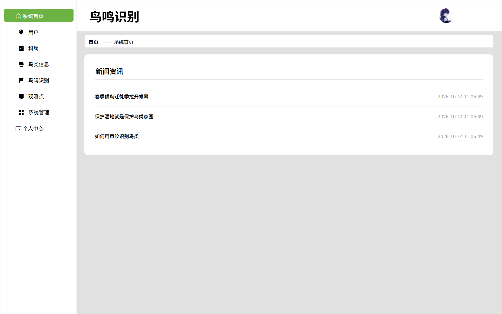
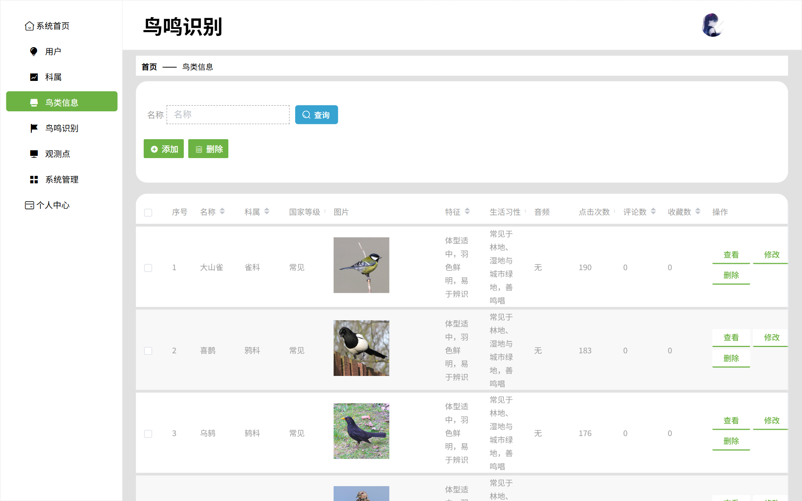
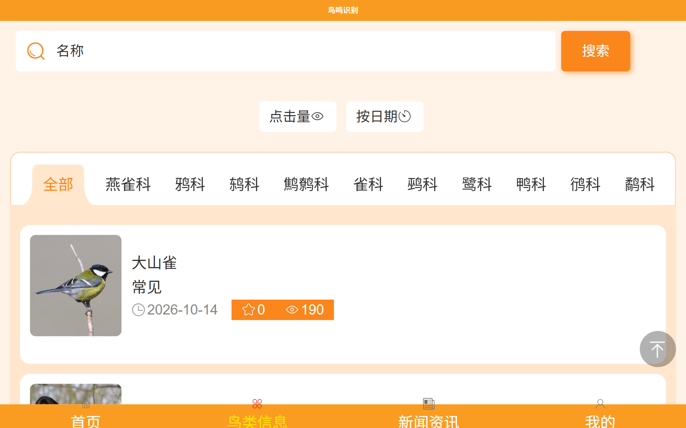
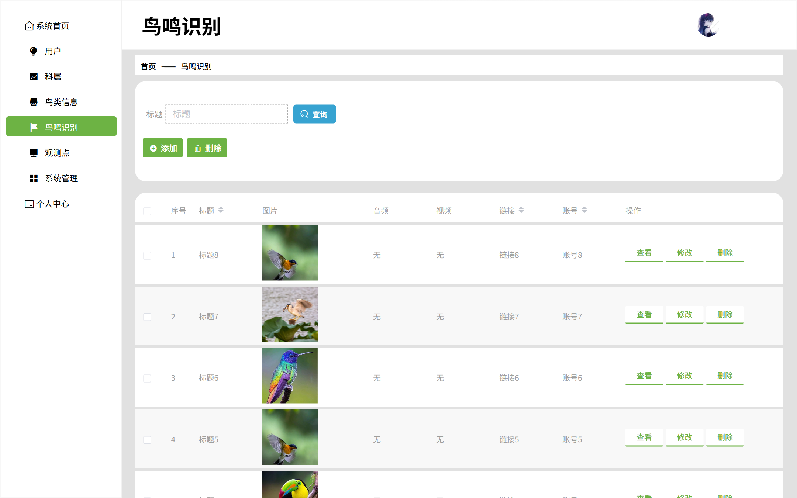
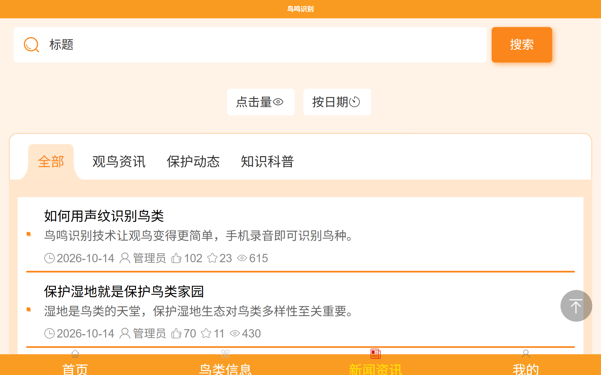
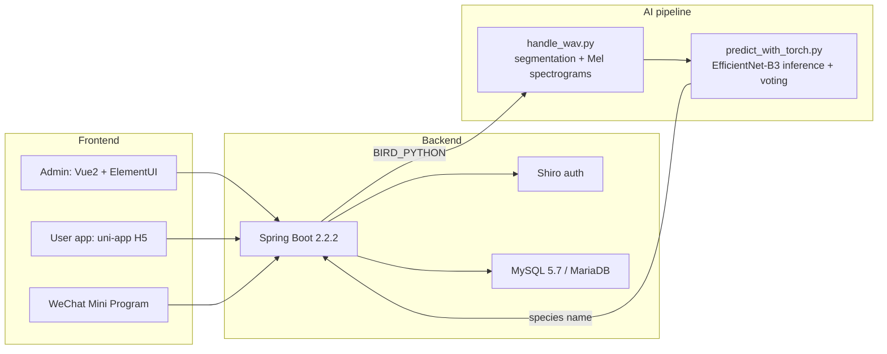

# Wenming Qingyun · Bird Song Recognition System

[中文](./README.zh-CN.md) | English

> A bird song recognition system based on convolutional neural networks (EfficientNet-B3): upload a bird song recording, and the system automatically identifies the species and returns bird information.
> Backend: Spring Boot · Admin: Vue2 + ElementUI · User app: uni-app H5 · WeChat Mini Program · AI: PyTorch deep recognition pipeline.

> **Project background:** This project was originally completed in 2023-2024. In 2026, the code, documentation, and runtime configuration were organized for GitHub portfolio display. The project retains the tech stack and some historical implementations from that time. It is published solely as a personal learning record and portfolio showcase, not as a production system or open-source project.

## Features

- **Bird song recognition**: upload a WAV recording → 15s sliding-window segmentation → Mel spectrograms → EfficientNet-B3 classification → majority vote over 16 spectrograms → returns species plus family/genus, habits, and encyclopedic info
- **Bird encyclopedia**: bird info and family management, including national protection level, characteristics, habits, introduction, and images
- **Content management**: news and observation-point management (admin)
- **User app**: bird browsing, recognition entry, news, observation points (H5 + WeChat Mini Program)
- **Admin**: admin login, data CRUD, image upload

## Screenshots

| Admin | User app |
|---|---|
|  |  |
|  |  |
|  |  |

## Architecture



## How recognition works

```
WAV recording
  │  handle_wav.py (pydub + ffmpeg)
  ▼
15s sliding-window segmentation (5s step; padded to 16 segments if shorter)
  │  librosa: 32 kHz resampling, 224×224 Mel spectrograms (fmin 80 / fmax 16000)
  ▼
16 Mel spectrograms
  │  predict_with_torch.py
  ▼
EfficientNet-B3 (100 bird classes, ImageNet-pretrained transfer learning)
  │  16 independent inferences → majority vote by frequency
  ▼
Species code (B000-B099) → backend looks up the database and returns bird info
```

## Directory structure

```
bird-song-recognition/
├── backend/              # Spring Boot backend (src + pom.xml + db/*.sql + 启动后端.bat + Dockerfile)
│   ├── db/               # springboot05qmpxx3.sql (12 tables), seed-data.sql (20 real bird species)
│   └── src/main/resources/{admin,front}/  # admin/user-app build artifacts (packaged into the jar)
├── frontend-admin/       # Admin source code (Vue2 + ElementUI)
├── frontend-web/         # User app source code (uni-app H5)
├── miniprogram/          # WeChat Mini Program (uni-app build output; see its README for configuration)
├── ai/                   # Recognition pipeline: scripts + requirements + bundled Python env + model + ffmpeg (see its README)
│   ├── handle_wav.py / predict_with_torch.py   # inference (preprocessing + EfficientNet-B3 voting)
│   ├── models/           # checkpoint1.pth trained weights (131 MB, distributed via GitHub Releases)
│   └── training/         # training pipeline: segmentation → spectrograms → train_with_torch.py (fully reproducible)
├── docs/                 # papers, development docs, database docs, screenshots
└── docker-compose.yml    # one-command startup: MySQL + backend
```

## Quick start

### Option 1: Docker one-command startup (recommended for reviewers)

```bash
# 1. Build the backend image (requires Maven + JDK 8 locally; only once)
cd backend && mvn -DskipTests package && cd ..

# 2. Start MySQL + backend in one command (auto-imports SQL and 20 real bird species)
docker-compose up -d

# 3. Verify
curl http://localhost:8080/springboot05qmpxx3/users/login?username=admin\&password=admin
```

Access: admin console at <http://localhost:8080/springboot05qmpxx3/admin/dist/index.html> (admin/admin)
User app at <http://localhost:8080/springboot05qmpxx3/front/h5/index.html>

> AI recognition inside Docker is optional: the bundled `ai/python` is Windows-only, so inside the container you need to install dependencies yourself in a Linux image as described in [ai/README.md](ai/README.md) and mount the weights (the `- ./ai:/ai:ro` mount point is already reserved in `docker-compose.yml`). Without the mount, all features except recognition work normally.

### Option 2: Local startup (Windows, full features including AI recognition)

### 0. Requirements

- JDK 8, Maven 3.3+ (to build the backend)
- MySQL 5.7 / MariaDB (port 33061, database `springboot05qmpxx3`, account root, password set per your local setup)
- AI recognition (optional): the `ai/` directory distributed with this repo contains a bundled environment (Python 3.10 + torch cu121 + model + ffmpeg),
  or install dependencies yourself: `pip install -r ai/requirements.txt` and place the model at `ai/models/checkpoint1.pth`

Download the model weights (GitHub Releases):

```bash
curl -L -o ai/models/checkpoint1.pth https://github.com/hema-ai-dev/bird-song-recognition/releases/download/v1.0.0/checkpoint1.pth
```

### 1. Import the database

```bash
mysql -h127.0.0.1 -P33061 -uroot -p < backend/db/springboot05qmpxx3.sql
mysql -h127.0.0.1 -P33061 -uroot -p < backend/db/seed-data.sql   # optional: 20 real bird species
```

### 2. Build and start the backend

```bash
cd backend
mvn -DskipTests package
java -jar target/springboot05qmpxx3-0.0.1-SNAPSHOT.jar --server.port=8080
# or double-click 启动后端.bat (auto-injects AI environment variables)
```

AI environment variables (defaults to the `ai/` directory under the working directory when unset):

| Variable | Description |
|---|---|
| `BIRD_PYTHON` | Python interpreter path (default `ai/python/python.exe`) |
| `BIRD_AI_DIR` | AI scripts directory (default `ai/`) |
| `FFMPEG_PATH` | ffmpeg path (default `ai/ffmpeg/bin/ffmpeg.exe`) |

### 3. Access

- Admin console: <http://localhost:8080/springboot05qmpxx3/admin/dist/index.html> (admin/admin)
- User app: <http://localhost:8080/springboot05qmpxx3/front/h5/index.html>

### 4. Test recognition

Upload a WAV recording on the user app's "Recognition" page, or call the API directly:

```bash
TOKEN=$(curl -s -X POST "http://localhost:8080/springboot05qmpxx3/users/login?username=admin&password=admin" | grep -o '"token":"[^"]*"' | cut -d'"' -f4)
curl -X POST "http://localhost:8080/springboot05qmpxx3/keshu/bird_recognition?data=uploaded-file-name.wav" -H "token: $TOKEN"
```

## Known limitations

- The model was trained on 100 bird classes (mainly North American songbirds plus some Chinese wetland birds); recordings outside this range are classified into the closest category
- The WeChat Mini Program is a uni-app build output with browsing features only (no recognition entry); see `miniprogram/README.md` for where to change the appid and baseUrl
- The admin/user-app UIs were built with reference to several generic admin templates and previous student projects available at the time; the provenance and licenses of some third-party parts cannot be fully traced now, and this repo grants no reuse license for them
- Baidu API keys have been removed from the code and are injected via environment variables (`BAIDU_APP_ID/API_KEY/SECRET_KEY/ACCESS_KEY/ACCESS_SECRET_KEY`); the related features are unavailable when these are not configured
- All three frontends point to `http://localhost:8080/springboot05qmpxx3/` by default; see `miniprogram/README.md` for the mapping table when deploying to a server

## License

This repository is not an open-source project; it is published solely for personal portfolio and educational demonstration purposes. Except where third-party components are used under their original licenses, you may not copy, modify, redistribute, sublicense, commercialize, or create derivative works from this project without prior written permission. See [LICENSE](LICENSE) for the full terms.

The recognition scripts and training pipeline in `ai/`, as well as the end-to-end bird song recognition integration, are the main original work of this project. Rights to third-party content such as UI templates, generic components, images, and fonts belong to their respective owners; this repo claims no exclusive rights over third-party parts whose provenance cannot be fully traced.

## Model weights

The weights file is not distributed with the repository (exceeds GitHub's 100 MB limit). Download it from Releases:

```bash
curl -L -o ai/models/checkpoint1.pth https://github.com/hema-ai-dev/bird-song-recognition/releases/download/v1.0.0/checkpoint1.pth
```
