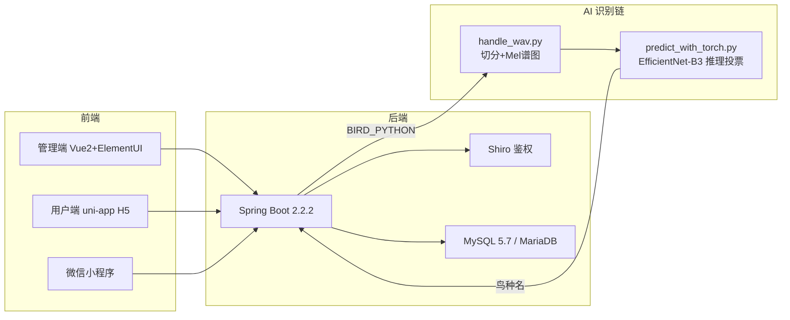

[English](./README.md) | 中文

# 闻鸣清韵 · 鸟鸣识别系统

> 基于卷积神经网络（EfficientNet-B3）的鸟鸣识别系统：上传一段鸟鸣录音，自动识别鸟的种类并返回鸟类信息。
> 后端 Spring Boot + 管理端 Vue2/ElementUI + 用户端 uni-app H5 + 微信小程序，AI 侧为 PyTorch 深度识别链。

> **项目背景：** 本项目最初于 2023—2024 年完成，2026 年为 GitHub 作品展示进行了代码、文档与运行配置整理。项目保留了当时使用的技术栈和部分历史实现，仅作为个人学习经历与项目作品展示，不作为生产系统或开源项目发布。

## 功能

- **鸟鸣识别**：上传 wav 录音 → 15s 滑窗切片 → Mel 谱图 → EfficientNet-B3 分类 → 16 图投票 → 返回鸟种及科属、习性等百科信息
- **鸟类百科**：鸟类信息、科属管理，含国家等级、特征、生活习性、简介、图片
- **内容管理**：新闻资讯、观测点管理（管理端）
- **用户端**：鸟类浏览、识别入口、资讯、观测点（H5 + 微信小程序）
- **管理端**：管理员登录、数据 CRUD、图片上传

## 截图

| 管理端 | 用户端 |
|---|---|
|  |  |
|  |  |
|  |  |

## 架构



## 识别原理

```
wav 录音
  │  handle_wav.py（pydub + ffmpeg）
  ▼
15s 滑窗切片（步长 5s，不足 15s 补足 16 份）
  │  librosa：32kHz 采样，mel 谱图 224×224（fmin 80 / fmax 16000）
  ▼
Mel 谱图 ×16
  │  predict_with_torch.py
  ▼
EfficientNet-B3（100 类鸟种，ImageNet 预训练迁移学习）
  │  16 张图独立推理 → 按出现频次投票
  ▼
输出鸟种编码（B000-B099）→ 后端回查数据库返回鸟类信息
```

## 目录结构

```
bird-song-recognition/
├── backend/              # Spring Boot 后端（src + pom.xml + db/*.sql + 启动后端.bat + Dockerfile）
│   ├── db/               # springboot05qmpxx3.sql（12张表）、seed-data.sql（20种真实鸟种）
│   └── src/main/resources/{admin,front}/  # 管理端/用户端构建产物（打进 jar）
├── frontend-admin/       # 管理端源码（Vue2 + ElementUI）
├── frontend-web/         # 用户端源码（uni-app H5）
├── miniprogram/          # 微信小程序（uni-app 编译产物，见其内 README 配置说明）
├── ai/                   # 识别链：脚本 + requirements + 绿色 Python 环境 + 模型 + ffmpeg（见其内 README）
│   ├── handle_wav.py / predict_with_torch.py   # 推理（预处理 + EfficientNet-B3 投票）
│   ├── models/           # checkpoint1.pth 训练权重（131MB，GitHub Releases 分发）
│   └── training/         # 训练流水线：切分 → 谱图 → train_with_torch.py（完整可复现）
├── docs/                 # 论文、开发文档、数据库文档、截图
└── docker-compose.yml    # MySQL + 后端一键启动
```

## 快速开始

### 方式一：Docker 一键启动（推荐给评审者复现）

```bash
# 1. 构建后端镜像（需本机有 Maven + JDK8，仅一次）
cd backend && mvn -DskipTests package && cd ..

# 2. 一键启动 MySQL + 后端（自动导入 SQL 和 20 种真实鸟种数据）
docker-compose up -d

# 3. 验证
curl http://localhost:8080/springboot05qmpxx3/users/login?username=admin\&password=admin
```

访问：管理端 <http://localhost:8080/springboot05qmpxx3/admin/dist/index.html>（admin/admin）
用户端 <http://localhost:8080/springboot05qmpxx3/front/h5/index.html>

> AI 识别在 Docker 内为可选：绿色 `ai/python` 是 Windows 版，容器内需按 [ai/README.md](ai/README.md) 在 Linux 镜像里自行安装依赖并挂载权重（`docker-compose.yml` 已预留 `- ./ai:/ai:ro` 挂载点）。不加挂载时除识别外的全部功能正常。

### 方式二：本地启动（Windows，全功能含 AI 识别）

### 0. 环境要求

- JDK 8、Maven 3.3+（编译后端）
- MySQL 5.7 / MariaDB（33061 端口，库名 `springboot05qmpxx3`，账号 root/123456）
- AI 识别（可选）：`ai/` 目录随仓库分发的绿色环境（Python 3.10 + torch cu121 + 模型 + ffmpeg），
  或自行安装依赖：`pip install -r ai/requirements.txt` 并把模型放到 `ai/models/checkpoint1.pth`

模型权重下载（GitHub Releases）：

```bash
curl -L -o ai/models/checkpoint1.pth https://github.com/hema-ai-dev/bird-song-recognition/releases/download/v1.0.0/checkpoint1.pth
```

### 1. 导入数据库

```bash
mysql -h127.0.0.1 -P33061 -uroot -p123456 < backend/db/springboot05qmpxx3.sql
mysql -h127.0.0.1 -P33061 -uroot -p123456 < backend/db/seed-data.sql   # 可选：20种真实鸟种数据
```

### 2. 编译并启动后端

```bash
cd backend
mvn -DskipTests package
java -jar target/springboot05qmpxx3-0.0.1-SNAPSHOT.jar --server.port=8080
# 或直接双击 启动后端.bat（自动注入 AI 环境变量）
```

AI 环境变量（未设置时默认取运行目录下 `ai/`）：

| 变量 | 说明 |
|---|---|
| `BIRD_PYTHON` | Python 解释器路径（默认 `ai/python/python.exe`） |
| `BIRD_AI_DIR` | AI 脚本目录（默认 `ai/`） |
| `FFMPEG_PATH` | ffmpeg 路径（默认 `ai/ffmpeg/bin/ffmpeg.exe`） |

### 3. 访问

- 管理端：<http://localhost:8080/springboot05qmpxx3/admin/dist/index.html>（admin/admin）
- 用户端：<http://localhost:8080/springboot05qmpxx3/front/h5/index.html>

### 4. 测试识别

用户端「识别」页上传 wav 录音，或直接调接口：

```bash
TOKEN=$(curl -s -X POST "http://localhost:8080/springboot05qmpxx3/users/login?username=admin&password=admin" | grep -o '"token":"[^"]*"' | cut -d'"' -f4)
curl -X POST "http://localhost:8080/springboot05qmpxx3/keshu/bird_recognition?data=上传返回的文件名.wav" -H "token: $TOKEN"
```

## 已知限制

- 模型训练集为 100 类鸟种（以北美常见鸣禽 + 部分中国湿地鸟类为主），超出范围的鸟鸣会归类到最接近的类别
- 微信小程序为 uni-app 编译产物，仅含浏览功能（不含识别入口）；appid 与 baseUrl 修改位置见 `miniprogram/README.md`
- 管理端/用户端界面参考并整合了当时接触的多份通用后台模板和往届学习案例；部分来源与许可目前无法完整追溯，仓库仅作作品展示，不对这些第三方部分授予再使用许可
- 百度 API 密钥已从代码移除，改为环境变量注入（`BAIDU_APP_ID/API_KEY/SECRET_KEY/ACCESS_KEY/ACCESS_SECRET_KEY`），相关功能未配置时不可用
- 三端请求地址默认 `http://localhost:8080/springboot05qmpxx3/`，部署到服务器需按 `miniprogram/README.md` 的对照表修改

## 许可

本仓库不是开源项目，仅用于个人作品集与学习成果展示。除各第三方组件按其原有许可使用外，未经事先书面许可，不得复制、修改、再分发、再许可、商用本项目或基于本项目制作衍生作品。完整条款见 [LICENSE](LICENSE)。

`ai/` 目录中的识别脚本与训练流程，以及鸟鸣识别的端到端集成，为本项目的主要原创工作。界面模板、通用组件、图片、字体等第三方内容的权利归其各自权利人所有；本仓库不对来源未完全追溯的第三方部分主张独占权利。

## 模型权重

权重文件不随仓库分发（超过 GitHub 100MB 限制），从 Releases 下载：

```bash
curl -L -o ai/models/checkpoint1.pth https://github.com/hema-ai-dev/bird-song-recognition/releases/download/v1.0.0/checkpoint1.pth
```
